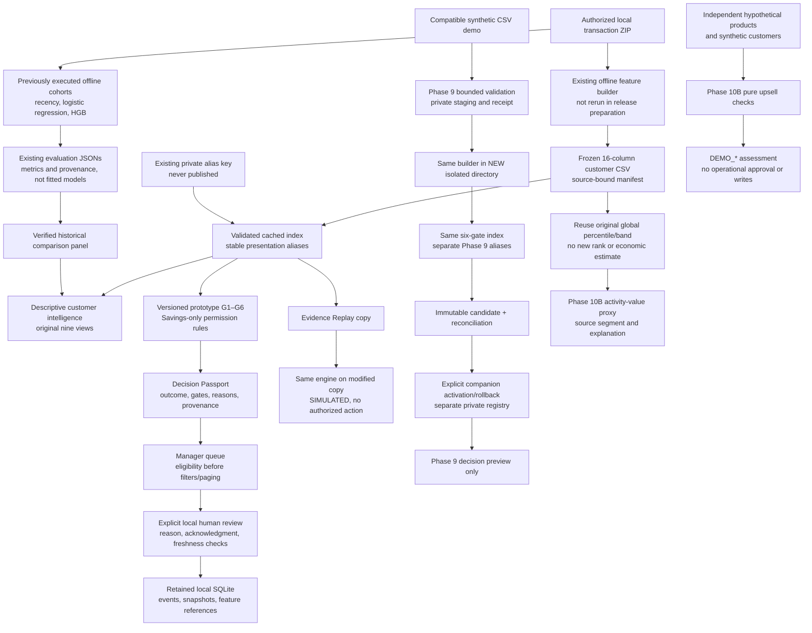

# Judge-friendly technical architecture

Banc-Inc360 is a local evidence-aware decision-support prototype. “Operational” below means the current prototype's deterministic permission path, **not a deployed bank service**. No live banking API, customer-message channel or financial execution service exists.

## Actual component/data flow

There is deliberately **no** arrow from historical metrics/DEMO_* statuses/research proposals to original gates, priority or review permissions; no Phase 9 activation arrow to the original dashboard loader; no replay write arrow to audit. The proposed Phase 10C predictive research companion **is not implemented and is not shown as an operational service**.

## Components and evidence

| Component | Implementation / responsibility | Boundary |
|---|---|---|
| Source/feature build | `build_data.run`; known finite non-fee events before cutoff, 180d/90d windows, recency, deposit rationale, absolute USD turnover, current snapshot evidence; manifest source/feature hashes | Existing canonical output never rebuilt/overwritten for this phase; current fields not historical predictors |
| Validated index | `data_access.load_index`, `provenance_issues`, `build_index`, `row_case`; required schema, identifier exclusions, consistent counts/ownership evidence; content/policy/key-bound cache | Unknown evidence does not silently become eligibility; raw IDs remain internal |
| Descriptive analytics | `analytics.portfolio_frame`, `activity_band`, `metrics`, `reason_distribution`; `segment_context` | Detached alias-safe frames; activity/volume not profitability; source segments not inferred clusters |
| Original shell/views | `app.py`, `ui_shell.PAGES`, `selection_controls`, nine `views/*.py`, `ui_views.py` | Stable global customer selection, explicit global KPI versus filtered table scope; no redesign |
| Gate authority | `engine.evaluate`, `evidence.validate` | ABSTAIN dominates CAUTION dominates SUPPORTED; no synthetic/model score override |
| Passport | `ui_components.passport_body`; source/policy/cutoff lineage, six reasons and human requirement | SUPPORTED is staff-review eligibility, not approved contact or product |
| Replay | `replay.simulate`, `ui_views.evidence_replay` | Counterfactual copy; reset; no original data/review mutation; not transaction-level source replay |
| Review persistence | `ReviewService.current`, `_assert_still_current`, `_fresh_case`, `open_case`, `record_review`; `AuditStore` | Current hashes/revision/idempotency, reason/acknowledgment, local snapshots/events; unverified demo identity, owner-trusted SQLite |
| Evidence/audit UI | `ui_review.render_audit_history`, `ui_views.audit_validation`, `evidence_trace.references` | Feature-level references; current snapshot dates unknown; older embedded test list differs from latest receipt |
| Offline ML | `historical_evaluation.cohort/evaluate/metrics/run`; two existing result directories | Five historical predictors, chronological repeated-customer holdout; no retained fitted runtime object |
| Historical display | `experimental_evidence.load_historical_comparison`, `ui_components.historical_ai_comparison` | Pinned JSON/version/source/code/cohort/metric checks; stale/missing evidence withholds metrics, not fallback numbers |
| Deployment configuration | `deployment_data.configuration/load_dataset` | Explicit LOCAL/DEPLOYED/DEMO; no silent demo substitution; release approval required for DEPLOYED; current guide is loopback LOCAL only |
| Phase 9 companion | `phase9_ingestion.validate_csv`, `SnapshotStore.process/_verify/activate/rollback`; `phase9_app.py` | 5 MiB/25,000-row USD-compatible input, exact reconciliation, separate key/registry/snapshots, 50-alias preview; no original dashboard switch |
| Phase 10B companion | `phase10b_upsell.validate_relationship/assess_upsell`; `phase10b_value.value_frame/selected_value_explanation`; `phase10b_app.py` | Entirely synthetic upgrade policy, distinct DEMO_* statuses; real data used only for unchanged activity proxy; no storage/action endpoint |

## Six gates in plain language

G1: Is the supplied typed evidence/lineage/linkage temporally consistent? G2: Is there enough history (0–1 block, 2–3 caution, >=4 pass)? G3: Is the action method approved within this prototype (deterministic rules; fitted action models not registered)? G4: Do current customer/account/KYC checks permit review? G5: Is this supported Savings proposal absent from known holdings and supported by behavior? G6: Will staff review/verify, with no automated outreach?

Original priority is `.45 × min(recency/90,1) + .35 × relationship_activity_percentile + .20 × service_issue`; exact unrounded values drive ordering with alias tie-break. It is not the historical raw-recency baseline, ML probability, profit or new Phase 10B proxy score. Review permissions are evaluated before queue paging; a score cannot make a blocked case actionable.

## Four distinct evidence lanes

1. **Deterministic permission lane:** original 50,000 decisions, Savings cross-sell, G1–G6, human local review.
2. **Historical research lane:** five-feature inactivity experiments and verified aggregate metrics; no live fitted inference.
3. **Synthetic demonstration lane:** independent Phase 9 CSV examples and Phase 10B hypothetical upgrades, clearly labelled and separately counted.
4. **Future proposals:** Phase 10C conditional research design only; no hidden inference service, saved model/scaler, calibrated probabilities or new bank authorization.

## Technical limits to defend

Source hashes bind local artifacts but do not certify bank source authenticity, feed completeness or effective dates. Current KYC/ownership is not a historical reconstruction. Original source quantities and stable global activity ranks do not establish profitability. Audit triggers/revisions protect application writes but are not tamper-proof against the database owner. Local SQLite survives restart only on retained storage; cloud durability is not verified. No production identity/access model, integration/API throughput or enterprise scale/SLA was established.

The accepted source/decision hashes verify; release conformance still carries the one `docs/.DS_Store` checksum exception in 01. This diagram explains the actual build, not a production deployment or an exemption from that freeze condition.
