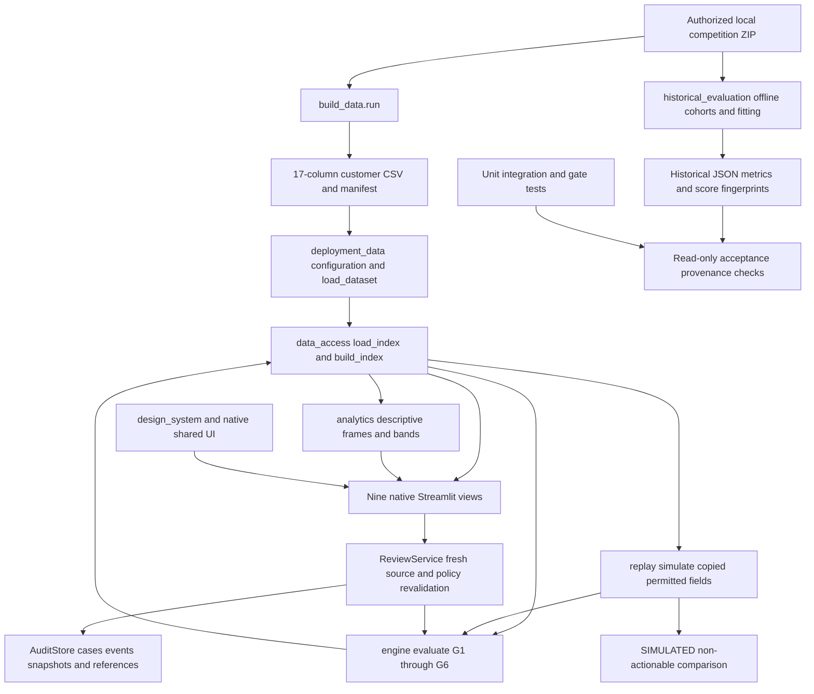

# Phase 8A — actual architecture and data flow

Audit date: 2026-11-18 (Africa/Harare). **Audit only; Phase 8B is not implemented or approved.** Local confidential evidence; no customer-level records or identifiers are included. VERIFIED = directly checked code/artifact/aggregate; INFERRED = reasoned conclusion; MISSING = not found in inspected scope; UNVERIFIED = not established by available evidence.

## Implemented architecture

There is deliberately no experimental-model edge into operational decisions, queue priority or review authorization. The historical JSON is not currently consumed by the application as a model comparison panel. Mermaid is documentation only; no diagram service or external app was used.

## File-level component inventory

All paths below are repository-relative. Component status is based on executable code, not concept-paper plans.

| Path; functions/classes | Inputs → outputs | Upstream / downstream | Classification |
| --- | --- | --- | --- |
| `app.py` module | configured data mode → Workspace/native page | deployment loader, UI shell → views | VERIFIED operational entry point |
| `deployment_data.py`; `configuration`, `portable_path`, `load_dataset`, `prepare_alias`, `audit_configuration` | env/top-level Streamlit secrets, artifact/manifest → validated index, runtime storage path | file inputs → app/review UI | VERIFIED operational; no downloader/publication |
| `data_access.py`; `row_case`, `load_index`, `_cached_index`, `build_index`, `DecisionIndex` | validated feature rows/manifest/key/policy → immutable complete decision index, aliases, pages/passports | evidence/engine → analytics/views/review | VERIFIED operational |
| `evidence.py`; `validate`, `holdings`, `state`, `number`, `safe_original` | raw typed feature evidence → normalized values/coded issues/safe evidence | row_case/evaluate → gates/passport | VERIFIED operational validation; PRODUCT_LABELS is ownership enum |
| `engine.py`; `Case`, `evaluate`, `POLICY_VERSION` | approved current case contract → six gates, rating/action/reasons/priority | evidence → index/replay/review | VERIFIED authoritative deterministic rules |
| `build_data.py`; `run`, `KNOWN_TYPES`, `file_hash` | original ZIP/cutoff → features, audit, manifest | source transaction/snapshot fields → loader/evaluation reconciliation | VERIFIED offline feature engineering; not invoked by app startup |
| `analytics.py`; `_frame`, `portfolio_frame`, `metrics`, `distribution`, `reason_distribution`, three band helpers | immutable index → safe descriptive frame/aggregates | index → nine views | VERIFIED operational descriptive analytics; source banking segment deliberately omitted |
| `ui_shell.py`; `Workspace`, `PAGES`, selection/provenance helpers | index/session/widget state → shared customer, page list, provenance | app → all views | VERIFIED operational shared state |
| `ui_components.py`; `metric_cards`, `bars`, `paginated`, `passport_body`, `review_notes` | existing metrics/passport → native visual components/session-only notes | index/analytics/design → views | VERIFIED presentation; session notes are separate from SQLite events |
| `design_system.py`; tokens, `apply_design`, `identity`, `gate_cards`, `replay_highlight`; `.streamlit/config.toml`, `assets/brand.svg` | existing results → escaped/refined UI | shared UI → all routes | VERIFIED Phase 7 student branding; preserve |
| `ui_views.py`; nine render functions | Workspace/current alias → charts/tables/filters/passports | shared UI/index/analytics/replay/review | VERIFIED operational views; no banking-segment or model-comparison panel |
| `replay.py`; `simulate`, `ALLOWED_FIELDS` | copied selected evidence plus permitted overrides → baseline/simulated/changed gates | index/evaluate → replay view | VERIFIED demo-only non-actionable computation, no persistence |
| `ui_review.py`; `store`, `service`, `render_workflow`, `queue_status`, `render_audit_history` | current alias/source, demo reviewer, reason → workflow/status/timeline UI | deployment/review/storage → Passport/Queue/Audit | VERIFIED operational prototype workflow; cloud storage warning |
| `review_service.py`; `CurrentEvidence`, `normalize_passport`, `ReviewService.current/open_case/refresh_case/record_review` | fresh current evidence + actor/reason/revision → transactional case event/snapshot | source/index/engine → AuditStore | VERIFIED application control boundary, no external authentication |
| `audit_store.py`; `AuditStore`, schema v1/DDL | file-backed SQLite → cases/events/reviewers/datasets/policies/snapshots/references | review service → queue/audit UI | VERIFIED local persistence; append-only triggers, not owner-resistant |
| `evidence_trace.py`; `references`, `DERIVATIONS` | hashes/cutoff/alias → eight feature-level derivations | review service → snapshot evidence | VERIFIED feature-level only; no invented transaction links |
| `historical_evaluation.py`; `audit_source`, `cohort`, `evaluate`, `metrics`, `bootstrap`, `run` | ZIP at two cutoffs → offline fitted experiments, JSON/CSV metrics | source → historical experiment artifacts | VERIFIED experimental; evaluate fits/predicts then discards estimator objects |
| `scripts/evaluate_history.py` | explicit local CLI → evaluation directory | historical evaluator | VERIFIED optional experiment CLI; not run in 8A |
| `outputs/phase5/evaluation/`, `evaluation_repeat/` | prior runs → metrics, cohort/config/code/data/score fingerprints | evaluator → acceptance checking | VERIFIED existing experimental artifacts, not fitted model binaries |
| `presentation.py`; init/read_config/environment; `scripts/presentation.py` | managed local config → isolated DB generation/launch/backup | loader/AuditStore → demo server | VERIFIED local demo operations; imports evaluator digest only, not inference |
| `acceptance_checks.py`; frozen reference/decision/source fingerprints | current code/data/JUnit → read-only checks | index → final acceptance scripts/tests | VERIFIED technical acceptance |
| `scripts/run_final_regression.py`, `verify_final_acceptance.py` | full pytest + hashes → run manifest/certificate | tests/index/experiment metadata → evidence | VERIFIED tooling; full runner not used in 8A due fitting test |
| `tests/` and `tests/fixtures/reference_local_baseline.json` | synthetic isolated fixtures plus authorized data → regression assertions | all components → JUnit | VERIFIED 443 recorded cases; safe 442 rerun |
| Saved estimator/scaler/tree artifacts; model registry/inference API | — | — | MISSING in inspected repository/artifact scope |
| Approved product catalogue/segment suitability service/learned recommender | — | — | MISSING; ownership enum and Savings prototype rule are not equivalent |

## Native page mapping

| Wrapper | `ui_views` render function |
| --- | --- |
| `views/executive_overview.py` | `executive_overview` |
| `views/customer_360.py` | `customer_360` |
| `views/inactivity_intelligence.py` | `inactivity_intelligence` |
| `views/relationship_value.py` | `relationship_value` |
| `views/product_opportunities.py` | `product_opportunities` |
| `views/decision_passport.py` | `decision_passport` |
| `views/evidence_replay.py` | `evidence_replay` |
| `views/manager_work_queue.py` | `manager_work_queue` |
| `views/audit_validation.py` | `audit_validation` |

`views/synthetic_demo.py` is a separate explicit synthetic route, not a tenth real-data banking capability. Missing real data does not silently become a demo (`deployment_data.load_dataset`). LOCAL and DEPLOYED have portable ROOT-based input handling; DEPLOYED requires release/version/hash/approval-reference settings. These are operator assertions, not proof of bank permission or host authentication.

## Planned versus implemented

The earlier concept's broad recommendation catalogue, learned product ranking, clustering, optimization/DecisionLab, FastAPI/Next.js services, production authentication and remote durable database are not implemented by this Streamlit code. Do not infer them from installed libraries or design documents. The current supported architecture is intentionally local, rule-authoritative and evidence-aware.
